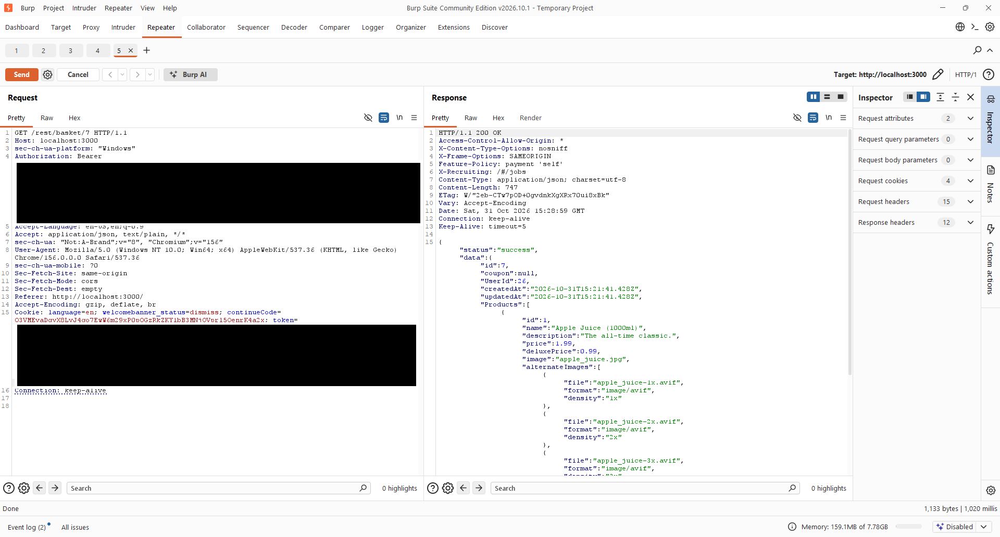
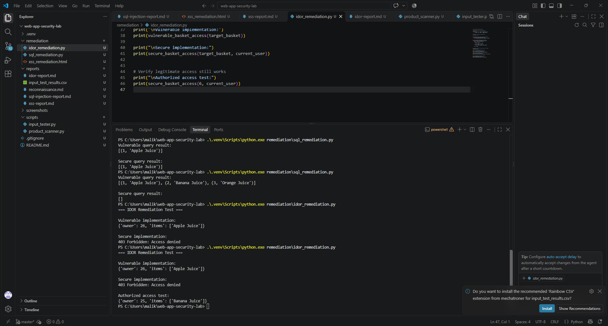

# Finding 003 — Broken Access Control (IDOR)

## Vulnerability
Insecure Direct Object Reference (IDOR) / Broken Object-Level Authorization

## Severity
High (Provisional)

## Affected Endpoint
GET /rest/basket/{basketId}

## Environment
OWASP Juice Shop — Local Docker Lab

## Description
The application allows an authenticated user to retrieve another user's shopping basket by modifying the basket ID.

## Proof of Concept
1. Created two test accounts.
2. Account 1 had basket ID 6.
3. Account 2 had basket ID 7 containing Apple Juice.
4. Authenticated as Account 1.
5. Modified GET /rest/basket/6 to GET /rest/basket/7.
6. Server returned Account 2's basket contents.

## Results
- HTTP 200 OK
- Returned basket ID 7
- Returned user ID 26
- Retrieved Apple Juice belonging to Account 2

## Security Impact
An authenticated user may access another user's basket information without authorization.

## Recommended Remediation
- Enforce server-side ownership checks.
- Validate authorization for every basket request.
- Return 403 Forbidden for unauthorized access.
- Retest using two independent user accounts.

## Evidence

## Status
Confirmed — Remediation pending.

## Remediation Validation

Created a Python demonstration comparing vulnerable basket access with secure server-side ownership validation.

### Results
- Vulnerable implementation: Returned another user's basket.
- Secure implementation: Denied cross-account access.
- Authorized access test: Successfully returned the authenticated user's own basket.

### Evidence

### Remediation Scope
The ownership check was validated in a separate Python demonstration.
The original OWASP Juice Shop application remains intentionally vulnerable.
