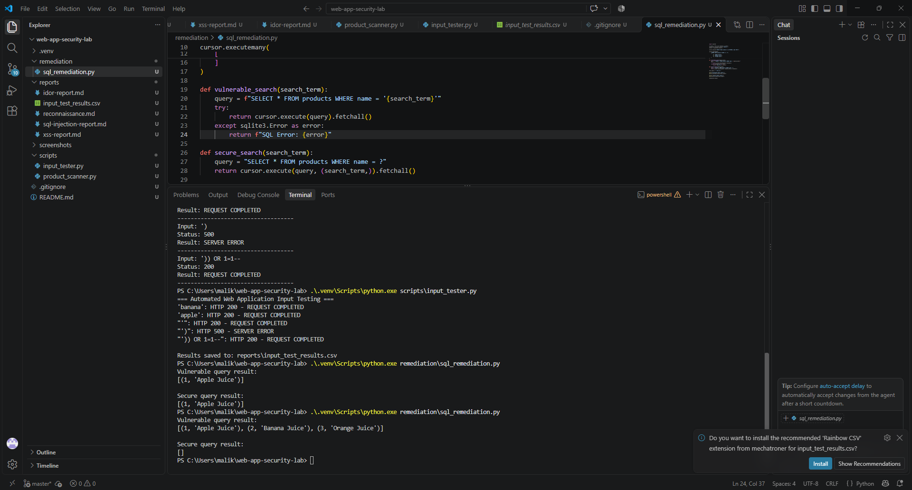

# Finding 001 — SQL Injection in Product Search

## Vulnerability
SQL Injection (SQLi)

## Severity
High (Provisional)

## Affected Endpoint
GET /rest/products/search

## Environment
OWASP Juice Shop — Local Docker Lab

## Description
The product search endpoint processes user-controlled input
in a way that allows manipulation of the underlying SQL query.

## Proof of Concept
Payload:
')) OR 1=1--

URL-encoded:
%27%29%29%20OR%201%3D1--

## Results
- Initial malformed input triggered SQLite syntax errors.
- The successful payload returned HTTP 200 OK.
- The response contained product records despite the
  absence of a legitimate product search term.
- SQL query manipulation was successfully demonstrated.

## Security Impact
SQL injection may allow attackers to bypass intended
query conditions or access unintended database records.

## Recommended Remediation
- Use parameterized SQL queries.
- Avoid concatenating user input into SQL statements.
- Apply appropriate input validation.
- Avoid exposing database errors to clients.
- Verify the remediation through repeated security tests.

## Evidence
- ../screenshots/sql-injection-error.png
- ../screenshots/sql-injection-success.png

## Status
Confirmed — Remediation pending.

## Remediation Validation

A separate Python SQLite demonstration was created to compare vulnerable SQL string concatenation against secure parameterized queries.

### Results
- Vulnerable query: SQL injection returned all three product records.
- Secure query: The same payload returned zero records.
- Parameterized queries successfully prevented SQL query manipulation.

### Evidence

### Remediation Scope
The fix was validated in a separate Python demonstration.
The original OWASP Juice Shop application remains intentionally vulnerable.
