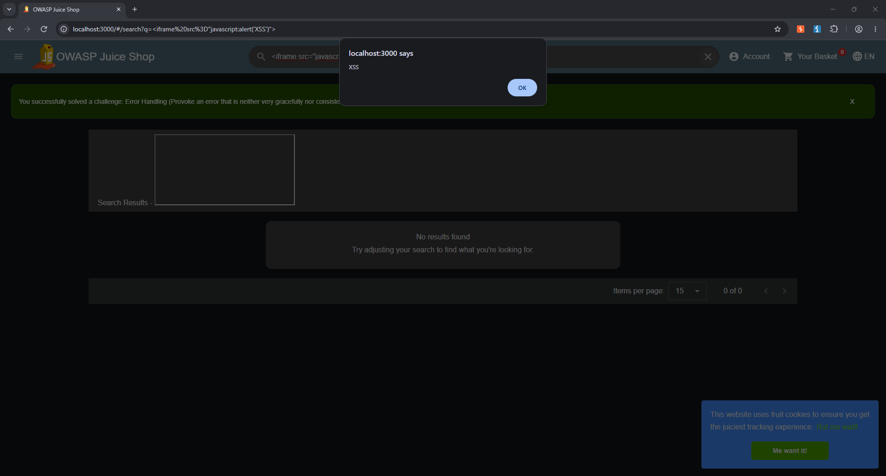
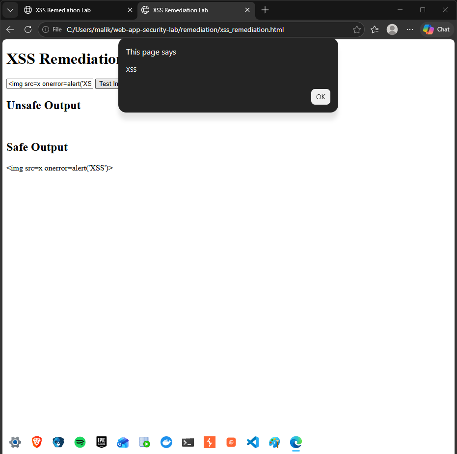

# Finding 002 — Cross-Site Scripting (XSS)

## Vulnerability
Cross-Site Scripting (XSS) — DOM-based

## Severity
Medium (Provisional)

## Affected Component
OWASP Juice Shop — Product Search

## Environment
Local Docker Lab — http://localhost:3000

## Description
The product search functionality was tested with a JavaScript payload to determine whether user-controlled input could be interpreted as executable content.

## Proof of Concept
Test payload:

`<iframe src="javascript:alert('XSS')">`

## Results
- Submitted the payload through the product search field.
- Captured the browser's behavior.
- Screenshot saved for evidence.
- JavaScript execution should be confirmed by an alert displaying "XSS".

## Security Impact
If untrusted input executes as JavaScript, attackers may be able to manipulate page content or perform actions in the context of a victim's browser session.

## Recommended Remediation
- Avoid inserting untrusted content into dangerous DOM sinks.
- Use context-appropriate output encoding.
- Sanitize HTML when rendering user-generated markup is necessary.
- Enforce a restrictive Content Security Policy as defense in depth.
- Retest the same payload after remediation.

## Evidence

## Status
Test performed — browser execution confirmation pending.

## Remediation Validation

Created a local HTML and JavaScript demonstration comparing unsafe `innerHTML` rendering with secure `textContent` rendering.

### Results
- Unsafe implementation: Executed the injected JavaScript and displayed an XSS alert.
- Secure implementation: Displayed the malicious input as plain text without executing JavaScript.
- The secure implementation prevented execution in the tested text-display context.

### Evidence

### Remediation Scope
The fix was validated in a separate JavaScript demonstration.
The original OWASP Juice Shop application remains intentionally vulnerable.
